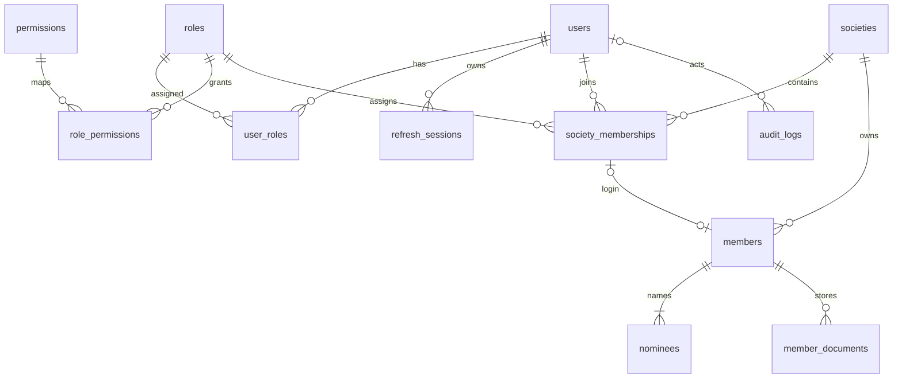

# Database design and upgrade plan

## Scope

Phase 1 implements identity, permissions, members, nominees, private photos, audit history and settings. Phase 2 implements accounts, transactions, transaction_entries, approval_policies and approval_steps for member savings; see [PHASE2.md](PHASE2.md) for the current schema, invariants and scope. The broader financial tables below remain a design contract for later increments. The installation supports multiple societies with independent role assignments and society-scoped business data. See [MULTI_SOCIETY.md](MULTI_SOCIETY.md) for the implemented tenant boundary, migration and administration workflow.

## Implemented tables

| Table | Purpose and important constraints |
| --- | --- |
| societies | Independent society identity, unique code, active flag, contact details, currency/timezone and version. |
| society_memberships | Society/user unique membership, scoped role and active flag. Composite keys constrain member login ownership. |
| users | Global login identity, unique case-insensitive normalized email, salted scrypt hash, active flag and mandatory initial password change. |
| roles | Five uniquely coded roles: SUPER_ADMIN, ADMIN, ACCOUNTANT, APPROVER, MEMBER. |
| permissions | Named API capabilities, independent of frontend navigation. |
| user_roles | Composite primary key; reserved for platform Super Admin. Society roles are assigned through society_memberships. |
| role_permissions | Composite primary key; permissions are resolved from the database on every authenticated request. |
| refresh_sessions | SHA-256 hashes of random refresh secrets, token family, expiry and revocation. No plaintext refresh tokens in SQL. |
| members | Durable membership identity, generated unique member number, optional society-scoped unique login link, profile, date, status, optimistic version and soft archive. |
| nominees | One-to-many nominees; exact DECIMAL(5,2) shares. API requires 1–10 nominees and a total of exactly 100.00%. |
| member_documents | Private storage metadata with member FK, document kind, MIME type, generated storage key, size and creation time. Phase 1 upload supports photos only. |
| audit_logs | Actor, action, target entity, timestamp and before/after details. Passwords and tokens are excluded. Business mutation and audit insert share one transaction. |
| system_settings | Society/key scoped JSON configuration, seeded with BDT, Asia/Dhaka and en-BD defaults. No public write endpoint in Phase 1. |
| file_deletions | Durable cleanup queue for superseded/removed private photo files, keyed by storage key with retry attempts. Created atomically with photo metadata deletion. |

Entity IDs are opaque strings; new entity records use CUIDs, foreign keys are indexed, and all tables use MySQL 8 InnoDB with utf8mb4_unicode_ci. MySQL collation makes email uniqueness case insensitive, while the API also normalizes emails. Nominees and documents use RESTRICT deletion. Member archival retains relational identities for future financial records. There is no member hard-delete API. Archival disables the society membership, preserving any access the same global identity has in other societies.

Photo replacement keeps one current PHOTO record per member. The service locks the member row before querying/replacing its photos, so simultaneous uploads cannot retain multiple current photos. Metadata deletion, cleanup jobs and audit records commit together. Physical file removal follows commit and retries from the durable queue after filesystem failures or process restarts. Deleting a photo requires the currently displayed document ID to avoid removing a concurrently replaced image. IDENTITY/OTHER documents are unaffected. The photo cleanup migration removes legacy superseded PHOTO records and queues their bytes for deletion, with deterministic date/ID ordering.

Member list indexes cover archive/date/id, archive/status, name and phone. Number and email are unique. Search uses bounded contains filters across name, number, email and phone. This is suitable for Phase 1; contains search is not an index seek. For large directories add a normalized search column or external search index and cursor pagination after measuring real queries. Pagination is capped at 100 rows. Stable sort uses ID as a tiebreaker.

UTC instants use DATETIME(3); membership date is DATE. The UI formats dates for Asia/Dhaka. Concurrent member changes use compare-and-increment version updates. Upload and login creation also increment the member version, so a stale edit cannot silently overwrite a newer change. Keep the database user's migration credentials separate from restricted runtime credentials in production.

## Later financial migrations

Use member and user IDs as foreign keys. Do not add floating-point balance columns to members. Display balances computed from the approved ledger (or transactionally maintained, reconcilable aggregates).

| Planned table/group | Key relationships and constraints |
| --- | --- |
| accounts | Chart of accounts: unique code, name, ASSET/LIABILITY/EQUITY/INCOME/EXPENSE, currency, optional parent account. Prevent parent cycles in the service. |
| bank_accounts | Bank identity, masked/display number, unique ledger account FK, active flag. Cash gets a separate asset account. |
| transactions | Header: unique transaction number, type, effective date, status, member FK where applicable, actor, currency, unique idempotency key, reversalOf FK and request reference. |
| transaction_entries | Header FK + line number unique, account FK, optional member subledger FK, DECIMAL(20,2) debit and credit. CHECK enforces exactly one positive side per line. Index account/date/header and member/date/header for reports. |
| approval_policies | Versioned policy by transaction type: required approvals 1 or 2, self-approval rule, eligible roles, effective date. Capture the policy version on each request. |
| approval_requests | Proposed create/correct/cancel operation, immutable proposed payload, entity/version reference, requester, policy version, PENDING/APPROVED/REJECTED. |
| approval_steps | Request FK, ordered step 1/2, decision, approver FK and decision timestamp; unique request/step and request/approver. |
| loans | Member FK, disbursement transaction FK, principal DECIMAL(20,2), agreed schedule/rate with explicit rounding policy, status. |
| loan_repayments | Loan FK, unique posted transaction FK, principal/charge components DECIMAL(20,2); no second source of truth for cash movement. |
| investments | Investment identity, counterparty, dates, principal DECIMAL(20,2), ledger transaction references, status. |
| investment_documents | Investment FK and private document metadata using the same storage service pattern. |
| investment_returns | Investment FK, cash transaction FK and principal/profit split. |
| profit_distributions + allocations | Distribution period/policy, approved transaction FK; per-member allocation and unique distribution/member. DECIMAL arithmetic and deterministic remainder allocation. |
| expenses | Category, payee, evidence metadata and unique approved transaction FK. |
| backup_logs | Requested/completed time, actor, encrypted artifact key, checksum, status, retention metadata and restore verification date. |

### Posting and approval invariants

1. Validate amounts as decimal strings and calculate with Prisma.Decimal or an equivalent decimal library. For BDT, postings use DECIMAL(20,2); percentages/rates may use DECIMAL(9,6). Define rounding per product and do not accept JS floating-point arithmetic as ledger logic.
2. Draft or pending requests never affect reports. One service owns ledger posting. In a single database transaction, lock the request/header and relevant subledger/limit rows, validate approvals, verify currency and active accounts, insert balanced lines and mark the header posted. SUM(debit) must equal SUM(credit) and be greater than zero. MySQL CHECK cannot enforce a sum across rows; the transactional posting service and its concurrency tests must enforce it.
3. A unique idempotency key and unique request-to-posted-transaction relation make retries safe. Handle constraint collisions by returning the original result; do not post twice. Lock member/account rows when checking available funds or outstanding principal to avoid concurrent overspending.
4. Approval decisions use compare-and-set state changes and unique approver constraints. Enforce distinct approvers and no requester approval where the captured policy requires segregation. Only the required final decision can invoke the posting service; audit decisions and posting atomically.
5. Posted headers and lines are immutable to application APIs. Corrections post an equal/opposite reversal plus a separately approved replacement. Cancellation reverses rather than deleting. Link originals, reversals, replacements and requests so reports explain every adjustment.
6. All future financial records reference retained members with RESTRICT FKs. Closed/archive status controls new activity, never historical reporting. Reports filter by effective date and POSTED state; opening balance + movement must equal closing balance.
7. Test balanced postings, rounding, duplicate submissions, concurrent approvals/withdrawals, rejection, self-approval, stale requests and reversals against MySQL before releasing each financial module.

### Growth and operations

Keep a modular monolith until load warrants separate services. Controllers validate transport, services own rules and transactions, repositories encapsulate complex queries. The current auth/members modules can be extended independently. Add new permissions in reviewed migrations/seeds and grant them explicitly; never infer access solely from a role label on the client.

Multiple societies are implemented through societies, society_memberships, mandatory X-Society-Id business context, composite tenant foreign keys and scoped uniqueness. Platform Super Admin manages societies; tenant roles apply only within the selected society. The migration preserves existing member IDs. Future financial tables and background/export/backup services must maintain the same scope; see MULTI_SOCIETY.md for the enforcement and test contract.

Use a shared rate-limit store and private object storage before multiple API replicas; the initial limiter and disk storage target a single API process. Pool size is bounded per process. Add session/audit retention jobs and monitor query latency before adding replicas or partitioning. Preserve audit events required for business history.

Offline backup is a later module: take a consistent MySQL dump plus referenced uploads into a versioned manifest, include checksums, encrypt using authenticated encryption, keep encryption keys outside the archive, record history, allow authorized download and document/test restoring into an isolated database. Backing up SQL alone cannot restore member photos. Do not advertise backup as implemented in Phase 1.
