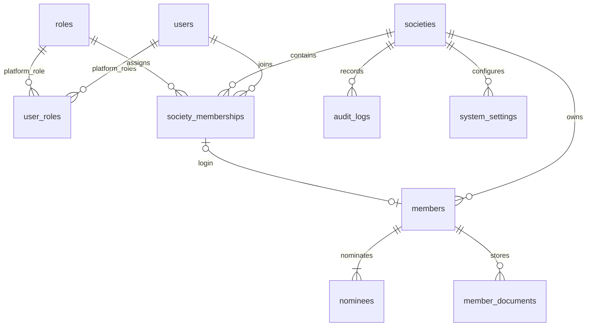

# Multiple societies and data isolation

The application now manages multiple societies in one MySQL database. Business records are separated by society, with enforced API scope and composite foreign keys. This is logical tenant isolation; it does not provision a separate MySQL server/database for every society.

## Administration workflow

1. Sign in as the existing platform Super Admin and open **Societies**.
2. Select **Add society**, enter its name/code/contact details and the first administrator's name, unique login email and temporary password.
3. Open that society from the list or choose it using **Current society** in the sidebar.
4. Its Admin uses **Team & access** to create Admin, Accountant or Approver accounts. Member logins are created from member profiles. These accounts receive access to that society only.
5. Every new login must change its temporary password. Members can view their own profile only; Approvers have read access until financial approval modules are implemented.

Only platform Super Admin can create/edit societies, enable/disable them or open societies without being a member. Ordinary society users cannot discover or select unrelated societies. Disabling a society blocks its business APIs and its users' access without deleting records. A Super Admin can reactivate it from the platform list.

## Data model

- `societies` owns the society identity, unique code, name, contact details, currency/timezone, active flag and optimistic version.
- `users` holds global login identities and salted password hashes. Login email is globally unique; a person does not get multiple passwords for the same identity.
- `user_roles` is reserved for the platform `SUPER_ADMIN` role. Society roles never grant platform authority.
- `society_memberships` assigns one role and active flag to a user within a society. `(societyId,userId)` is unique. The structure supports one identity with different roles in multiple societies; permissions are resolved separately for each request and are never combined across societies.
- `members` has society-scoped unique member numbers, emails and login links. Its optional login link references the membership's composite `(societyId,userId)` key. It cannot point to a user who lacks membership in that society.
- `nominees` and `member_documents` reference `(societyId,memberId)` to the corresponding member's `(societyId,id)`. A mismatched society/member pairing fails at the database level, even outside the API.
- Business `audit_logs` include societyId; authentication/password events concern the global identity and may be platform scoped. `system_settings` uses `(societyId,key)` as its primary key.
- Physical photo storage uses opaque, globally unique storage keys outside the public web root. Downloads require authentication, a valid active society and membership/record ownership. Knowing another society's document ID is insufficient. Cleanup jobs are internal system work and have no public endpoint.

The current provisioning forms create new login identities with unique emails. There is no invitation/link-existing-account UI yet. The membership model already supports multiple societies for one identity without a future schema rewrite; such linking needs a dedicated, reviewed invitation or platform administration workflow before exposure through the UI. Reusing a profile contact email across societies is supported independently of global login identity uniqueness.

## API scope and authorization

Login/refresh and `/api/auth/me` return `isSuperAdmin`, `societyId`, the current `society`, available `societies`, current roles/permissions and the current society's memberId. An access token authenticates an identity/session; it does not grant access merely because a client supplies a society ID.

Every business API request must include `X-Society-Id`. The backend validates the active society and membership before resolving permissions. Missing selection returns 400; a non-member's forged selection returns 403. A valid user in Society B requesting a Society A record receives 404 (or a permission denial for member-only roles). Super Admin business requests are also scoped to the selected society; the platform society list is a separate route.

All member list/detail/update/archive/login, staff list/create, dashboard, photo upload/remove/download queries use the validated society ID. Client payloads cannot assign society ownership. Staff provisioning accepts only ADMIN/ACCOUNTANT/APPROVER, and member login provisioning always assigns MEMBER. Tenant Admin cannot create a platform Super Admin.

Mutation transactions lock the active society for shared access and then the relevant member row/version. This prevents a society from being disabled mid-write, while preserving concurrent operations within it. Photo replacement/removal still queues disk cleanup atomically with metadata changes and audit history.

Archiving a member disables that society's membership; it does not disable the global user or revoke their other society access. Password changes and logout are identity/session operations and retain their documented global behavior.

## Browser switching

The current society is stored per tab in sessionStorage, not in a shared browser-wide token. Access tokens remain in memory and refresh secrets remain HttpOnly cookies. API retries preserve the original request's society header, so a retry cannot accidentally execute in a newly selected society. Switching validates membership via `/auth/me` and loads a fresh document, clearing the previous society's profiles, lists and open-form state.

## Migration of the existing installation

Migration `202611090004_multi_society` creates a first society with ID `legacy-society`, code `DEFAULT` and the previous configured society name (or Somity). Existing member IDs, member numbers, nominees, photo metadata/storage keys, user IDs and passwords remain intact. Non-platform role assignments become memberships in that first society. Super Admin retains platform authority. Existing business audit events and settings are assigned to the first society.

The local SQL and upload backup was saved under `.local/pre-tenancy/` before applying the migration. The migration was rehearsed against a temporary restored copy, including added legacy Admin/Member fixtures, then applied to the development and test databases. Use a maintenance window, a matching application release and a verified SQL/uploads backup for other installations. MySQL DDL is not a single rollbackable transaction; do not deploy old API code against the new schema. Rerunning the admin seed does not reset an existing password.

The initial society can be renamed through **Societies → Edit**. Existing member profile URLs continue to work when that society is selected.

## Verification and future financial tables

Tests cover two societies with identical profile contact emails/member numbers; scoped dashboards, user lists and role creation; forged headers; cross-society reads/writes and photos; platform escalation; composite FK rejection; one identity with ADMIN in A and MEMBER in B; disabled societies; archival preserving other memberships; and browser creation/switching with distinct Admin/Approver logins.

Future accounts, transactions, entries, approvals, loans, investments, expenses, profits, reports and backups must carry societyId. Use composite foreign keys for all business relationships and society-scoped idempotency keys, account codes and transaction numbers. Tenant context must remain mandatory in posting/reporting/export/backup services. Authorization isolation tests must accompany each new module. Financial modules and per-society automated backups remain outside the current Phase 1 implementation.
