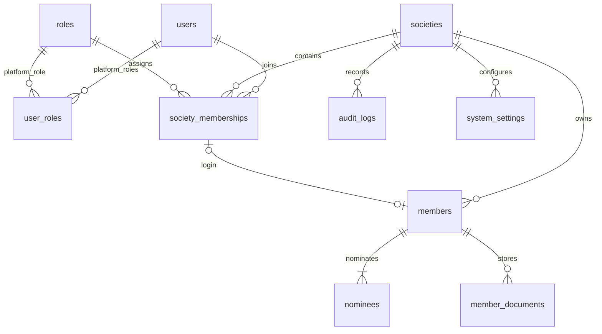

# Multiple societies and data isolation

The application now manages multiple societies in one MySQL database. Business records are separated by society, with enforced API scope and composite foreign keys. This is logical tenant isolation; it does not provision a separate MySQL server/database for every society.

## Administration workflow

1. Sign in as the existing platform Super Admin and open **Societies**.
2. Select **Add society**, enter its name/code/contact details and the first Society Admin's name, unique login email and temporary password.
3. Open that society from the list or choose it using **Current society** in the sidebar.
4. Use **Team & access → Add admin account** as Super Admin to give a user financial access to every active society. Admins choose a society from **Current society** before working on its transactions.
5. A Society Admin uses **Team & access** to create Society Admin, Accountant or Approver accounts within their society. Member logins are created from member profiles.
6. Every new login must change its temporary password. Members can view their own profile and approved savings statement. Approvers can read financial records and decide approval requests.

Only Super Admin can create, edit, enable or disable societies. Super Admin and Admin can open any active society. Society staff and members can select only societies with an active membership. Disabling a society blocks its business APIs while retaining its records. A Super Admin can reactivate it from the platform list.

## Data model

- `societies` owns the society identity, unique code, name, contact details, currency/timezone, active flag and optimistic version.
- `users` holds global login identities and salted password hashes. Login email is globally unique; a person does not get multiple passwords for the same identity.
- `user_roles` assigns platform `SUPER_ADMIN` and `ADMIN` roles. `ADMIN` includes finance permissions and the member and dashboard reads needed to work in a society. Member and staff management belongs to Super Admin and the assigned Society Admin.
- `society_memberships` assigns one role and active flag to a user within a society. `(societyId,userId)` is unique. The structure supports one identity with different roles in multiple societies; permissions are resolved separately for each request and are never combined across societies.
- `members` has society-scoped unique member numbers, emails and login links. Its optional login link references the membership's composite `(societyId,userId)` key. It cannot point to a user who lacks membership in that society.
- `nominees` and `member_documents` reference `(societyId,memberId)` to the corresponding member's `(societyId,id)`. A mismatched society/member pairing fails at the database level, even outside the API.
- Business `audit_logs` include societyId; authentication/password events concern the global identity and may be platform scoped. `system_settings` uses `(societyId,key)` as its primary key.
- Physical photo storage uses opaque, globally unique storage keys outside the public web root. Downloads require authentication, a valid active society and membership/record ownership. Knowing another society's document ID is insufficient. Cleanup jobs are internal system work and have no public endpoint.

The current provisioning forms create new login identities with unique emails. There is no invitation/link-existing-account UI yet. The membership model already supports multiple societies for one identity without a future schema rewrite; such linking needs a dedicated, reviewed invitation or platform administration workflow before exposure through the UI. Reusing a profile contact email across societies is supported independently of global login identity uniqueness.

## API scope and authorization

Login/refresh and `/api/auth/me` return `isSuperAdmin`, `societyId`, the current `society`, available `societies`, current roles/permissions and the current society's memberId. An access token authenticates an identity/session; it does not grant access merely because a client supplies a society ID.

Every business API request must include `X-Society-Id`. The backend validates the active society and checks for a platform role or an active membership before resolving permissions. Missing selection returns 400 and an unauthorized society selection returns 403. A user operating in Society B who requests a Society A record receives 404 when the user has permission to read that type of record. The selected society scopes business requests for Admin and Super Admin too.

All member list/detail/update/archive/login, staff list/create, dashboard, photo upload/remove/download queries use the validated society ID. Client payloads cannot assign society ownership. Staff provisioning accepts `SOCIETY_ADMIN`, `ACCOUNTANT` and `APPROVER`. Member login provisioning assigns `MEMBER`. Super Admin provisions cross-society `ADMIN` accounts through `/api/platform/users`.

Mutation transactions lock the active society for shared access and then the relevant member row/version. This prevents a society from being disabled mid-write, while preserving concurrent operations within it. Photo replacement/removal still queues disk cleanup atomically with metadata changes and audit history.

Archiving a member disables that society's membership; it does not disable the global user or revoke their other society access. Password changes and logout are identity/session operations and retain their documented global behavior.

## Browser switching

The current society is stored per tab in sessionStorage, not in a shared browser-wide token. Access tokens remain in memory and refresh secrets remain HttpOnly cookies. API retries preserve the original request's society header, so a retry cannot accidentally execute in a newly selected society. Switching validates membership via `/auth/me` and loads a fresh document, clearing the previous society's profiles, lists and open-form state.

## Migration of the existing installation

Migration `202611090004_multi_society` creates a first society with ID `legacy-society`, code `DEFAULT` and the previous configured society name (or Somity). Existing member IDs, member numbers, nominees, photo metadata/storage keys, user IDs and passwords remain intact. Non-platform role assignments become memberships in that first society. Super Admin retains platform authority. Existing business audit events and settings are assigned to the first society.

The local SQL and upload backup was saved under `.local/pre-tenancy/` before applying the migration. The migration was rehearsed against a temporary restored copy, including added legacy Admin/Member fixtures, then applied to the development and test databases. Use a maintenance window, a matching application release and a verified SQL/uploads backup for other installations. MySQL DDL is not a single rollbackable transaction; do not deploy old API code against the new schema. Rerunning the admin seed does not reset an existing password.

The initial society can be renamed through **Societies → Edit**. Existing member profile URLs continue to work when that society is selected.

Migration `202611160002_admin_scope` moves existing `ADMIN` memberships to `SOCIETY_ADMIN`, retaining their users, passwords and society assignments. Apply it with `npm run db:migrate` before deploying the updated API. New cross-society Admin accounts are created by Super Admin through **Team & access**.

## Verification and future financial tables

Tests cover two societies with identical profile contact emails/member numbers; scoped dashboards, user lists and role creation; forged headers; cross-society reads/writes and photos; platform escalation; composite FK rejection; one identity with ADMIN in A and MEMBER in B; disabled societies; archival preserving other memberships; and browser creation/switching with distinct Admin/Approver logins.

Phase 2 accounts, transactions, entries and approvals carry societyId, with composite tenant foreign keys and scoped permissions; see [PHASE2.md](PHASE2.md). Future loans, investments, expenses, profits, reports and backups must maintain this boundary. Use composite foreign keys for all business relationships and society-scoped idempotency keys, account codes and transaction numbers. Tenant context must remain mandatory in posting/reporting/export/backup services. Authorization isolation tests must accompany each new module. Loans/investments and per-society automated backups remain later increments.
